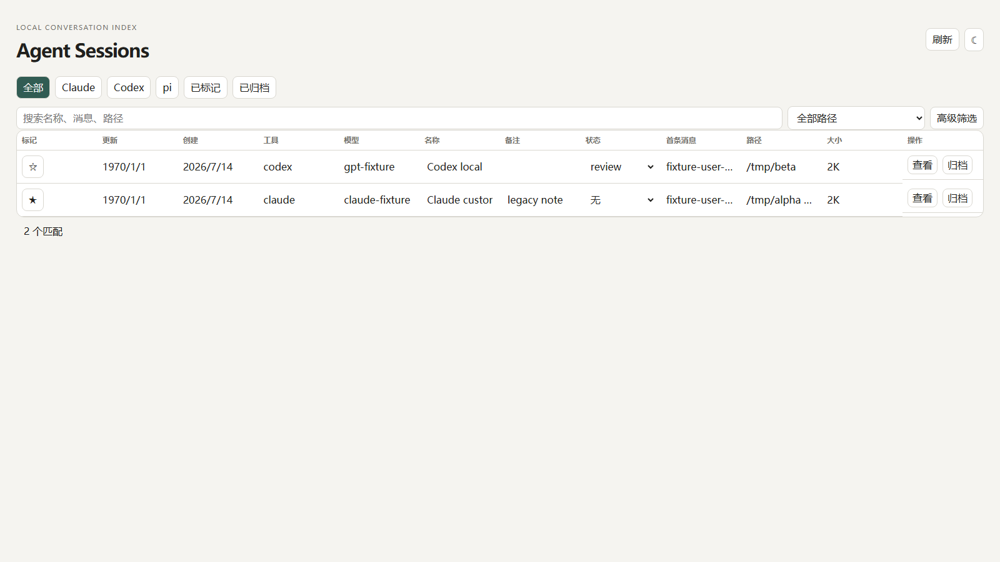
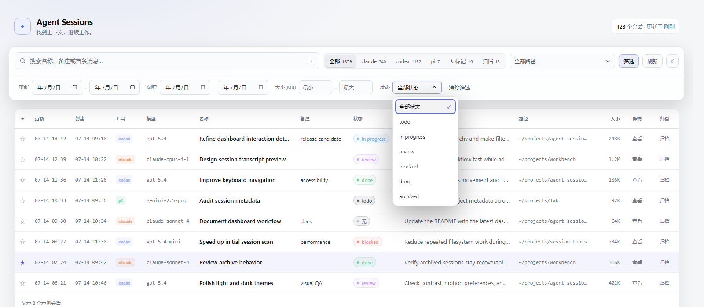
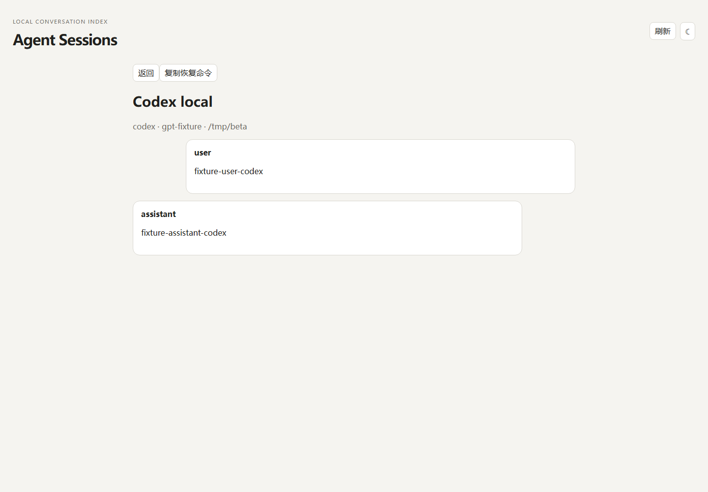

# Agent Sessions

快速找到 Claude Code、Codex 或 pi 的历史对话，看清工作如何在 Session 之间
流转，并通过可直接执行的恢复命令从原项目继续。

[English](README.md)



Agent Sessions 是一个本地 Dashboard 和 CLI，适合同时使用多个编码 Agent、
维护多个项目的人。它直接读取各工具已经保存在本机的历史记录，不需要导入，
也不需要登录云端账号。

## 你可以用它做什么

- **检索用户直接创建的 Session**：按工具、项目路径、日期、状态、大小、名称、
  备注、首条消息或完整 Transcript 检索 Claude Code、Codex 和 pi 的历史；
  不包含工具内部的子 Agent Session。
- **回到原处继续工作**：复制经过安全转义的恢复命令，自动回到原工作目录，
  并沿用最后使用的模型。
- **阅读完整对话**：在独立详情页中查看 Markdown 渲染后的用户与 Agent 消息，
  支持浏览器前进和后退。
- **整理有价值的工作**：使用标记、名称、备注、状态和可恢复归档管理 Session。
- **查看 Session 血缘**：识别一个 Session 写出 Markdown/HTML 文件、另一个
  Session 接手的过程；悬停 Session 或文件即可聚焦直接上下游。
- **手动补全漏掉的血缘**：为当前 Session 添加上游；加错后可以取消。手动
  关系在刷新、重启和自动索引重建后仍会保留。
- **从终端自动化**：为其他 Agent 和脚本提供稳定的 JSON 输出。

## 快速开始

Agent Sessions 需要在 `PATH` 中安装
[ripgrep](https://github.com/BurntSushi/ripgrep)（`rg`）。

1. 从 [GitHub Releases](https://github.com/aswrise/agent-sessions/releases)
   下载与你的系统和架构匹配的文件。
2. 将文件改名为 `sessions`（Windows 为 `sessions.exe`）；Linux/macOS 还需
   添加执行权限，然后放入 `PATH`。
3. 启动 Dashboard：

```bash
sessions dash
```

正常情况下浏览器会自动打开；也可以手动访问 `http://127.0.0.1:7867/`。
Dashboard 只监听本机地址。

```bash
sessions dash --no-open  # 启动但不打开浏览器
sessions dash --stop     # 停止常驻 Dashboard
```

预构建的 x64 发布文件使用 Bun 标准 target，可能要求 CPU 支持 AVX2。较老的
Linux 或 Windows x64 CPU 请使用下文的 baseline 源码构建命令。

## 使用 Dashboard

### 查找并恢复 Session

使用 **普通** 检索名称、备注和首条消息；切换到 **深度** 并按 Enter，可检索
可读 Transcript 全文。还可以按工具、项目路径、更新/创建日期、大小和状态
进一步筛选。

点击本机表格行会复制恢复命令；旧来源复制归档路径或符合条件的 pi 新建分支
命令。打开 Transcript 详情后，可点击对应名称的复制按钮。按 `/` 可快速聚焦
搜索框，按 `Esc` 可退出详情页。



### 整理工作

- 点击 ☆ 标记重要 Session。
- 点击本机名称或任意备注单元格直接编辑。旧来源名称只读。
- 设置 `todo`、`in progress`、`review`、`blocked`、`done` 等状态。
- 完成的工作可以归档；之后仍能从 **归档** 页签找回并恢复。

### 看懂 Session 血缘

打开 **关系图**，首次使用时点击 **开始分析**。Agent Sessions 会增量识别
Session 之间的文件交接，并按从上游到下游的方向排列。悬停 Session 或 FILE
卡片可聚焦相关路径；点击 Session 可查看它的 Transcript 和完整上下游链路。

如果自动分析漏掉了一次交接：

1. 打开下游 Session。
2. 点击 **补充上游**，选择对应的上游 Session。
3. 如果加错，在该手动上游旁点击 **取消关联**。

自动识别的 Artifact 关系保持只读；只有标记为 `MANUAL / 手动关联` 的关系
可以取消。

### 阅读 Transcript

详情页会把 Session 元信息、恢复操作、关系链和可读的 user/assistant 消息放在
一起，便于确认上下文后继续工作。



## CLI 命令

Session ID 可以缩写为任意不重复的前缀。

| 命令 | 用途 |
| --- | --- |
| `sessions list -n 30` | 列出所有工具、所有项目中的最近 Session |
| `sessions list claude` | 只看 `claude`、`codex` 或 `pi` |
| `sessions find "关键词"` | 检索摘要和可读 Transcript 文本 |
| `sessions show 48e17d64` | 查看一个完整 Transcript |
| `sessions index` | 增量分析跨 Session 的文件交接 |
| `sessions lineage 48e17d64` | 查看完整上下游连通链 |
| `sessions star 48e17d64 "备注"` | 标记 Session，并可附带备注 |
| `sessions unstar 48e17d64` | 取消标记 |
| `sessions stars` | 列出所有已标记 Session |
| `sessions dash` | 启动或重新打开 Dashboard |

`list`、`find`、`show`、`index` 和 `lineage` 均可添加 `--json`，获得稳定的
机器可读输出。

## 登记旧会话来源

本机三套默认会话目录无需配置。额外旧目录登记在应用数据目录的
`sources.json` 中。POSIX 的默认位置是
`~/.local/share/session-snapshots/sources.json`，Windows 是
`%LOCALAPPDATA%\session-snapshots\sources.json`。环境变量
`AGENT_SESSIONS_SOURCES_FILE` 可指定其他文件；库调用方可传
`CatalogOptions.sourcesFile`，优先级高于环境变量。配置可能包含私人路径，
请留在本机。

```json
{
  "version": 1,
  "sources": [
    {
      "id": "snapshot-2024",
      "label": "旧电脑快照",
      "scope": "personal",
      "roots": [
        { "id": "claude", "tool": "claude", "path": "~/Archives/laptop/claude-projects" },
        { "id": "codex", "tool": "codex", "path": "~/Archives/laptop/codex-sessions" },
        { "id": "pi", "tool": "pi", "path": "~/Archives/laptop/pi-sessions" },
        { "id": "pi-extra", "tool": "pi", "path": "~/Archives/other/pi-sessions" }
      ],
      "cwdMappings": [
        { "from": "/old/projects/example", "to": "~/Projects/example" }
      ],
      "continuationDirectory": "~/SessionContinuations/pi"
    }
  ]
}
```

`version` 和 `sources` 必填。每个来源需要稳定且唯一的 `id`，以及至少一个
根目录。每个根目录需要来源内唯一的 `id`、`claude`、`codex` 或 `pi` 中的
一种 `tool`，以及 `path`。ID 只能含字母、数字、点、下划线和连字符，且以
字母或数字开头；`live` 是保留值。`label` 默认使用来源 ID，`scope` 是可选的
展示标签，不代表工具访问授权。同一工具可登记多个根目录。路径必须是绝对
路径或 `~/` 路径，Windows JSON 路径需要转义反斜杠。页面不提供配置编辑器。

首次打开、每次刷新和 CLI 默认列表、检索都包含全部已登记来源。
`scope` 可以使用任意标签，不影响加载规则。来源筛选默认全部，只缩小显示结果和深度检索的
显示范围。刷新会重新读取配置并发现所有根目录的新文件，期间保留已有列表；
完成后保留筛选，页码越界时收回最后一页。库调用方使用
`list({ fresh: true })` 重新扫描，普通列表和详情可复用当前缓存。来源缺失或
配置无效会显示诊断，其余来源继续工作。离线记录暂时不显示，但标记和手动
关系继续保留，来源恢复后可再次看到。

旧目录支持平铺或多层 JSONL，按工具格式读取，排除已识别的内部子会话和损坏
记录。有效小文件也会显示；本机目录保留现有 2 KiB 下限以兼容已有行为。
扫描信息包含发现、有效和跳过数量。逃出根目录的软链文件会跳过。同一真实
文件重复登记只显示一次，本机来源优先，其次按配置顺序。不同快照的独立
文件即使原始 ID 相同，也各自保留。

旧来源的行 `id` 是稳定记录键，由来源 ID、根目录 ID、工具、原始会话 ID 和
相对文件路径生成。`session_id` 单独保留工具原始 ID。详情、检索、标记、
血缘均使用行 `id`。需要保留标注时，不要更改来源 ID、根目录 ID 或相对路径。
本机会话继续使用原始 ID 和原有裸 ID 标注。本机多个文件使用相同 ID 时，
仍由更新时间最新的文件提供唯一一行。归档副本使用独立记录键和标注。
名称和 Codex 元数据各自跟随根目录。
旧 Codex 根目录可以包含自己的 `session_index.jsonl` 和 `state_5.sqlite`，
不会借用本机数据库，也不会跟随数据库路径读到根目录之外。
SQLite 名称、首条消息和模型只用于真实 rollout 路径与原始 ID 都匹配的具体文件；
外部旧路径无法匹配时，使用文件自身元数据。
读取旧 SQLite 时，先把数据库和可选 WAL 复制到临时应用数据目录，再打开副本，
避免 SQLite 在归档目录创建或更新附属文件。

旧来源禁止原生改名。标星、备注、状态和手动关系只写 Agent Sessions 应用
数据。自动血缘只在同一来源内建立；明确添加的手动关系可以跨来源。

本机 `resume_command` 保持现有行为。旧来源 JSON 使用 `primary_action`，
包含 `path` 或 `fork` 类型的 `kind` 以及要复制的 `value`，不提供误导性的
`resume_command`。任何日期的旧 Claude 都复制路径，旧 Codex 当前也复制
路径。每行另有独立的源文件路径复制操作。复制不会启动终端、工具或模型。

旧 pi 在条件齐全时复制
`cd ... && pi --fork <归档文件> --session-dir <继续目录>`。工作目录映射使用
最长目录前缀，并检查目录边界及映射结果是否存在。历史 `from` 支持 POSIX 或
Windows 路径，`to` 使用当前机器的文件系统路径。继续目录需要提前创建、可写，
并位于全部归档根目录和本机 pi 存储之外，也会检查软链真实路径。
条件不足就回落为复制源文件路径。命令会正确转义参数，不继承归档中的模型
或 provider。该文件行为已用 pi 1.3.0 离线验证，验证不包含真实 TUI 对话或
provider 调用。若希望刷新后显示新分支，可把独立继续目录另行登记为来源。

## 本地数据与隐私

Agent Sessions 直接读取本地文件，不会上传 Transcript 数据。

| 工具 | Session 来源 |
| --- | --- |
| Claude Code | `~/.claude/projects/<路径-slug>/*.jsonl` |
| Codex | `~/.codex/sessions/YYYY/MM/DD/rollout-*.jsonl` 及只读索引 |
| pi | `~/.pi/agent/sessions/<路径-slug>/*.jsonl` |

扫描、检索、详情和自动血缘分析不会修改源 Session。明确改名时会按各工具的
本地命名方式写入。标记、备注、状态和归档保存在 `stars.json`；
手动血缘保存在 `manual-lineages.json`；可随时重建的自动血缘缓存是
`lineage.sqlite`。POSIX 下这些文件位于
`~/.local/share/session-snapshots/`，原生 Windows 下位于平台本地应用数据
目录。

如果标注和手动血缘很重要，请备份 `stars.json` 和 `manual-lineages.json`；
`lineage.sqlite` 无需备份。

## 从源码构建

安装 Bun 1.3.14 和 `rg` 后执行：

```bash
bun install --frozen-lockfile
bun run compile
install -m 755 build/sessions ~/.local/bin/sessions
```

较老且不支持 AVX2 的 x64 CPU 可构建对应 baseline target：

```bash
bun scripts/compile.ts --target bun-linux-x64-baseline
bun scripts/compile.ts --target bun-windows-x64-baseline
```

如果只想在源码目录运行、不构建独立可执行文件：

```bash
bun install --frozen-lockfile
bun run build
./sessions dash
```

## 开发

```bash
bun run test                    # Bun seam 测试 + Vue DOM 测试
bun run typecheck               # vue-tsc --noEmit
bun run build                   # Vite 构建并内联资源
bun run compile                 # 构建当前主机独立可执行文件
bun scripts/real-data-check.ts  # 只读形状/数量检查，不输出 Transcript 文本
```

发布流程覆盖 Linux、macOS、Windows 的 x64 与 ARM64，生成 SHA-256 文件，
并明确记录哪些目标真正执行过烟测。
